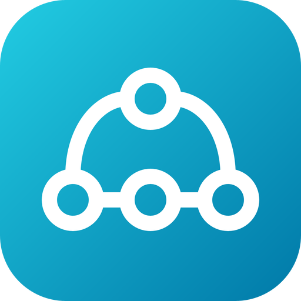
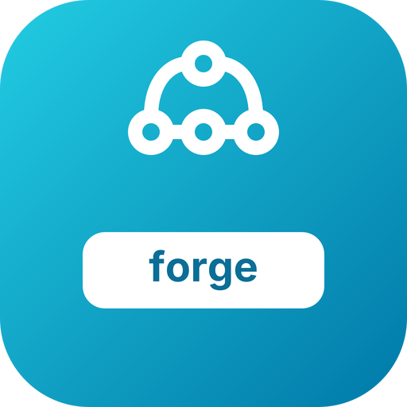
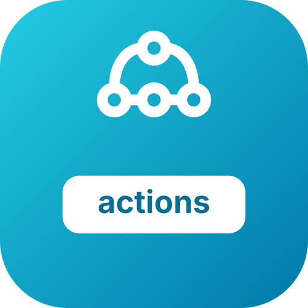

# go-vcs — brand assets

Official logos for the **go-vcs** organization and its repositories
(`go-vcs`, `go-vcs-forge`, `go-vcs-gitproto`, `go-vcs-actions`).

## Formats

Each file is named after its subject, for example `avatar/go-vcs-forge.png`.

- **SVG** — `svg/color`, `svg/white` (white, transparent), `svg/black` (black, transparent)
- **PNG** 16→1024 px, 3 variants — `png/<variant>/<size>/`
- **JPG** (color, white background) — `jpg/<size>/`
- **ICO** (Windows) — `ico/`
- **ICNS** (macOS) — `icns/`
- **GitHub avatar** 512 px — `avatar/`
- **Social preview** 1280×640 (repo banner) — `social/`

`python3 check/kit.py` counts the whole matrix; CI runs it on every change.

---
*Auto-generated assets — rounded square badge, line glyph (a commit graph), color / white / black variants.*
